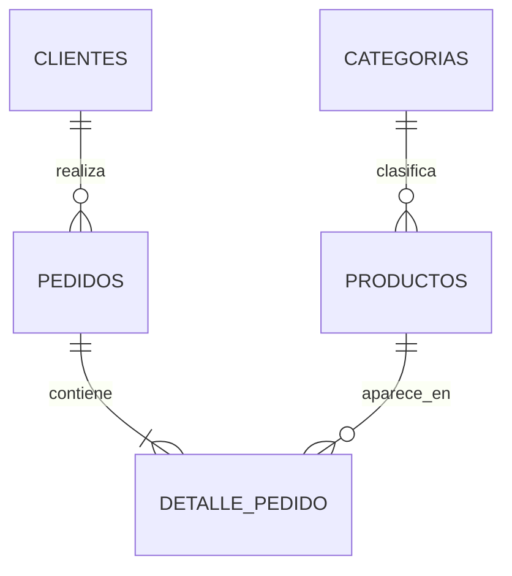

# E-commerce Sales & Customer Analytics
[](https://github.com/FabianRojasGamboa/ecommerce-sales-analytics/actions/workflows/data-quality.yml)

Proyecto de análisis comercial de un comercio electrónico ficticio en Chile. Utiliza Python y PostgreSQL para generar datos sintéticos, modelar relaciones, validar la calidad de los datos y responder preguntas de negocio mediante SQL.

## Objetivos

- Medir ingresos, ticket promedio y evolución mensual de ventas.
- Identificar productos, categorías y clientes de mayor valor.
- Analizar recurrencia e inactividad de clientes.
- Preparar una fuente de datos reutilizable para Power BI.

## Tecnologías

Python 3.10+ (biblioteca estándar), PostgreSQL 14+ y SQL (JOIN, CTE, agregaciones y funciones de ventana).

## Modelo relacional



| Tabla | Granularidad | Filas generadas |
|---|---|---:|
| categorias | Una categoría | 8 |
| productos | Un producto | 200 |
| clientes | Un cliente | 5.000 |
| pedidos | Un pedido | 30.000 |
| detalle_pedido | Un producto por pedido | 70.625 |

Datos completamente sintéticos, con semilla fija 42, fechas entre 2023 y 2025, descuentos simulados y diferentes probabilidades de compra. No representan una empresa ni personas reales. Se asume CLP como moneda del escenario ficticio.

## Flujo de trabajo

1. Generación de CSV reproducibles con Python.
2. Validación automatizada de claves, referencias, fechas, cantidades y precios.
3. Creación de tablas y carga transaccional en PostgreSQL.
4. Validación SQL y análisis de indicadores comerciales.
5. Vista de ventas preparada para una futura visualización en Power BI.

## Cómo ejecutar

Desde la raíz del repositorio, con Python y PostgreSQL instalados y un usuario autorizado para crear bases de datos (ajusta `-U postgres` si corresponde):

```bash
python scripts/generate_data.py
python -m unittest discover -s tests -v
createdb -U postgres ecommerce_analytics
psql -U postgres -d ecommerce_analytics -v ON_ERROR_STOP=1 -f sql/create_tables.sql
psql -U postgres -d ecommerce_analytics -f sql/load_data.sql
psql -U postgres -d ecommerce_analytics -v ON_ERROR_STOP=1 -f sql/data_validation.sql
psql -U postgres -d ecommerce_analytics -v ON_ERROR_STOP=1 -f sql/sales_analysis.sql
psql -U postgres -d ecommerce_analytics -v ON_ERROR_STOP=1 -f sql/bi_views.sql
```

En Windows, si `python` no está disponible, utiliza `py`. Los ejecutables PostgreSQL deben estar en PATH. Los CSV se generan localmente y no se versionan. No hay dependencias externas de Python.

**Advertencia:** `load_data.sql` vacía y recarga las cinco tablas del proyecto dentro de una transacción. Ejecutar solo en una base dedicada a este proyecto. Si ya existe una base antigua con otro esquema, crear una nueva para aplicar todas las restricciones.

## Indicadores y resultados de referencia

Resultados calculados directamente sobre los CSV generados, utilizando únicamente pedidos completados para ventas:

| Indicador | Resultado |
|---|---:|
| Pedidos completados | 25.509 |
| Ingresos simulados | $11.642.130.100 |
| Ticket promedio | $456.393,04 |
| Clientes compradores | 4.712 |
| Clientes con dos o más pedidos completados | 4.198 |

El ticket promedio utiliza el total de cada pedido, no el promedio de sus líneas. Los ingresos usan el precio histórico de cada detalle, después de descuentos simulados. No se calculan utilidades, impuestos, devoluciones ni costos logísticos. La inactividad se define como ausencia de compras completadas o última compra anterior a seis meses respecto del último pedido del dataset. La generación de clientes y pedidos condiciona las tendencias; no deben interpretarse como evidencia de mercado real.

## Consultas de negocio

`sql/sales_analysis.sql` contiene diez análisis: ingresos totales y mensuales, productos líderes, ventas por categoría, clientes de mayor gasto, ticket promedio, recurrencia, crecimiento mensual mediante `LAG`, ranking por categoría mediante `DENSE_RANK` e inactividad. El crecimiento compara meses observados consecutivos; en conjuntos con meses ausentes se requiere un calendario completo.

## Estructura

```text
scripts/generate_data.py     # Generación reproducible
sql/create_tables.sql        # Modelo, restricciones e índices
sql/load_data.sql            # Carga CSV con psql
sql/data_validation.sql      # Controles SQL
sql/sales_analysis.sql       # Preguntas de negocio
sql/bi_views.sql             # Vista de ventas para BI
tests/test_data.py           # Pruebas de integridad CSV
docs/power-bi.md             # Propuesta de dashboard
```

## Estado y próximos pasos

Generador y pruebas CSV ejecutados correctamente. La ejecución integral de PostgreSQL queda pendiente de validación en una instalación local. El dashboard Power BI aún no está desarrollado; se incluye una propuesta para implementarlo sin presentar resultados visuales inexistentes.
